<div align="center">


# Munshi AI

### Your personal accountant you can talk to.

**Say what you spent the way you'd tell a friend. Munshi ji keeps the books, catches money leaks, and tells you what to do next.**

`Voice-first` · `Built for India 🇮🇳` · `Gemini AI` · `Built by voice with Wispr Flow`

### 🚀 [Try it live → munshi-ai.finance-coach.workers.dev](https://munshi-ai.finance-coach.workers.dev)

Free, no sign-up. Click **Try with demo data**, or **Import my transactions → Use sample** to bring in a sample bank statement.

<br />

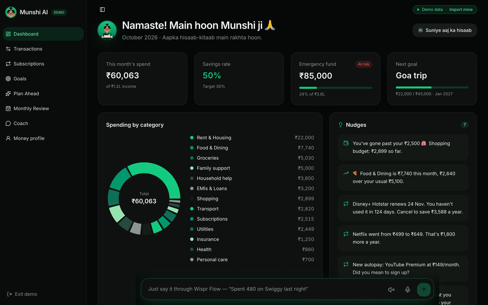

</div>

---

## 💡 The problem

Budgeting apps sort your transactions into categories and stop there. They don't know your goals, they don't learn when you fix a mistake, and logging an expense feels like filling out a form, so most people give up within a week.

For most Indians, money already has a *munshi*: the old-school accountant who listened, kept the books, and quietly warned you when things looked off. **Munshi AI brings that back, in your pocket, and you just talk to it.**

## 🎙️ Talk, don't type

```
 🗣️  "uh, so I spent like 450 on Swiggy last night, no wait, 480, and 200 on an Uber"
                                   │
                                   ▼
 🧠  Gemini (or the on-device parser)  →  ₹480 · Swiggy · Food & Dining · yesterday
                                          ₹200 · Uber · Transport · today
                                   │
                                   ▼
 📒  Logged, categorised, checked against your budget and goals, and Munshi ji replies out loud
```

Dictate with **Wispr Flow** (or the built-in 🎤 mic). Filler words, "no wait" corrections and several spends in one sentence are all handled. Before anything is saved, **"What Munshi heard"** shows exactly how your words were read: fillers in grey, take-backs struck through in red.

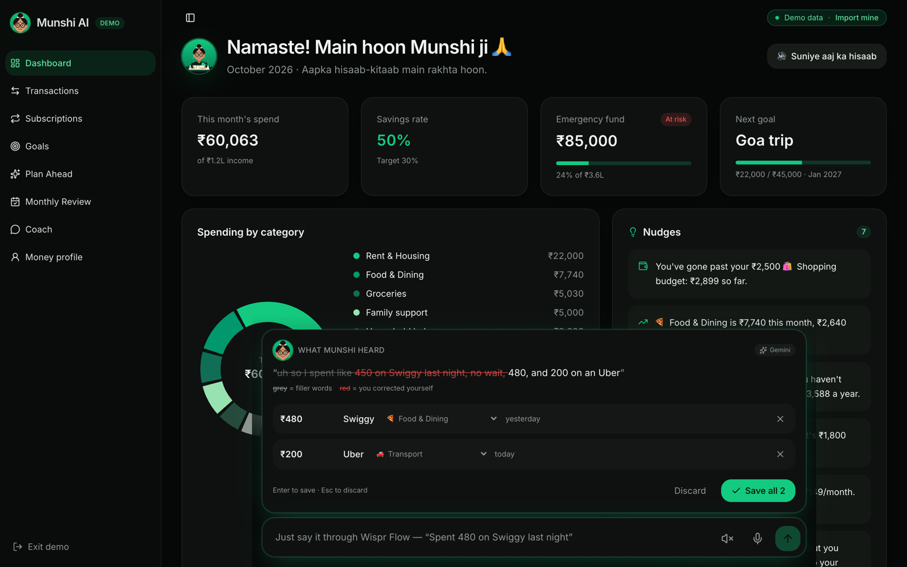

## ✨ Features

| | Feature | What it does |
|---|---|---|
| 🎙️ | **Voice command bar** | On every page. Messy, natural speech becomes clean entries; Munshi ji answers in Hinglish and speaks it with a Hindi voice |
| 📥 | **Import real bank data** | Bank statement **PDF** (password-protected works), **CSV**, or pasted **bank SMS**. Read on your device; nothing leaves the browser. Rows Munshi isn't sure about land in **"need a look"** |
| 🧠 | **Learns from corrections** | Fix a category once and choose **Remember**: past and future spends from that merchant are refiled. Works by voice too: *"Swiggy is food, not groceries"* |
| 🔁 | **Subscription radar** | Finds recurring payments on its own and flags **price hikes** (Netflix ₹499 → ₹649), **unused** services (Hotstar, 124 days) and **new autopays** |
| 🔔 | **Nudges when you drift** | Compares each category with your budget, or with your usual spend over the last 3 months, and speaks up early, never about rent or medicine |
| 🎯 | **Goals that talk back** | Emergency fund, Goa trip, laptop: *Ahead*, *On track* or *At risk*, with the monthly amount each one needs |
| 🔮 | **Plan Ahead** | *"What if I spend half as much eating out?"* *"What if I add a car EMI?"* See the effect on savings and every goal date |
| 📅 | **Monthly review** | A report card for any month, with highlights, a 6-month trend, and a downloadable PDF report |
| 🤖 | **Coach** | Ask *"Can I afford a ₹40,000 phone by March?"* and get an answer from **your** numbers, read aloud |
| 👤 | **Money profile** | Income, fixed costs, emergency-fund size, monthly budgets and goals, all saved in your browser |

<table>
  <tr>
    <td width="50%">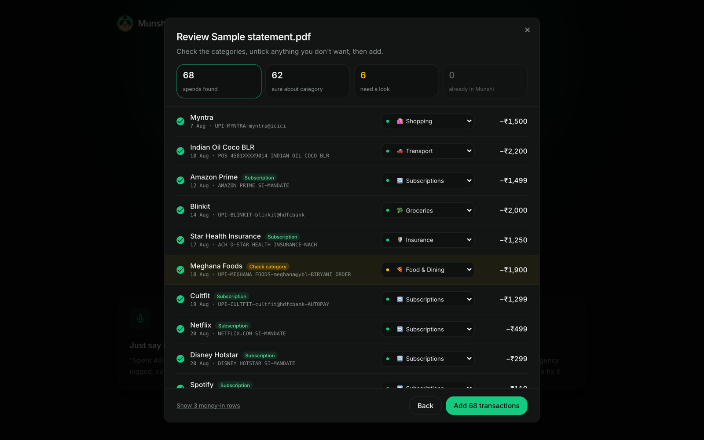<br /><b>Import a statement.</b> 68 spends read from a PDF; the 6 Munshi isn't sure about are flagged.</td>
    <td width="50%">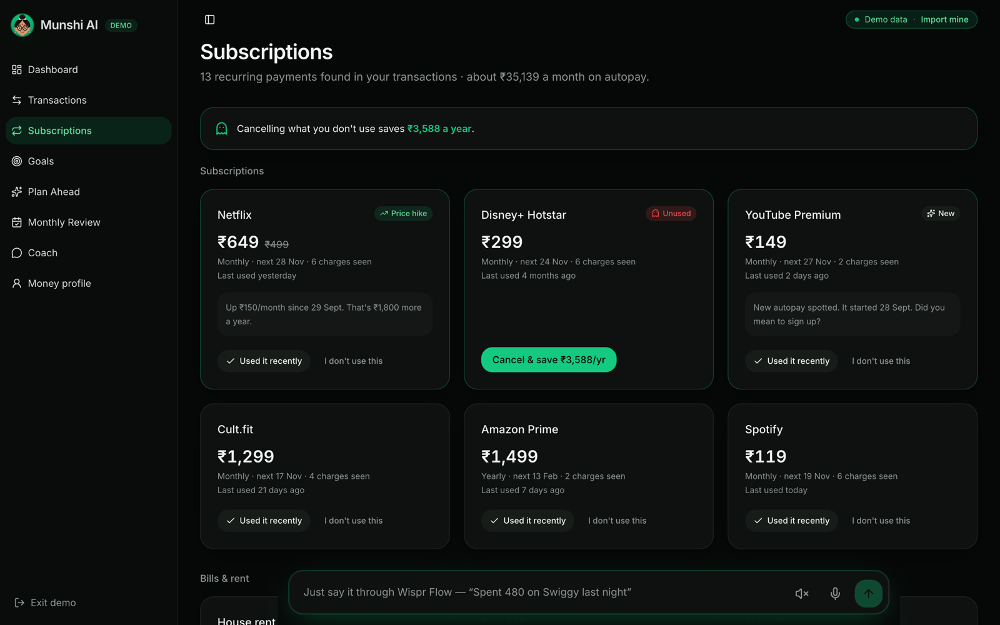<br /><b>Subscription radar.</b> Price hikes, unused services and new autopays, found in your transactions.</td>
  </tr>
  <tr>
    <td>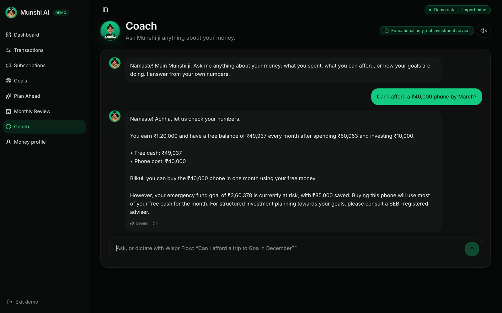<br /><b>Coach.</b> Answers from your real income, spending and goals, powered by Gemini.</td>
    <td>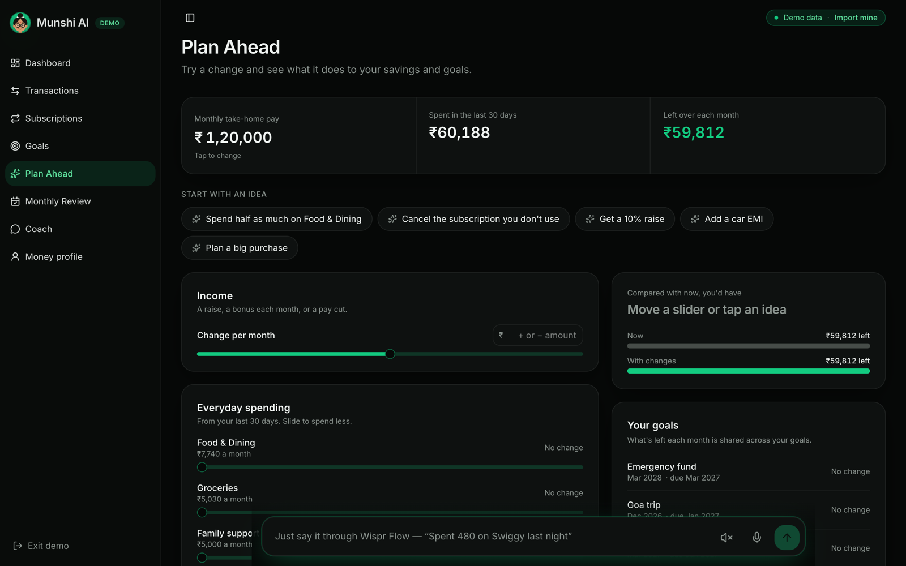<br /><b>Plan Ahead.</b> Try a change and watch your savings and goal dates move.</td>
  </tr>
  <tr>
    <td>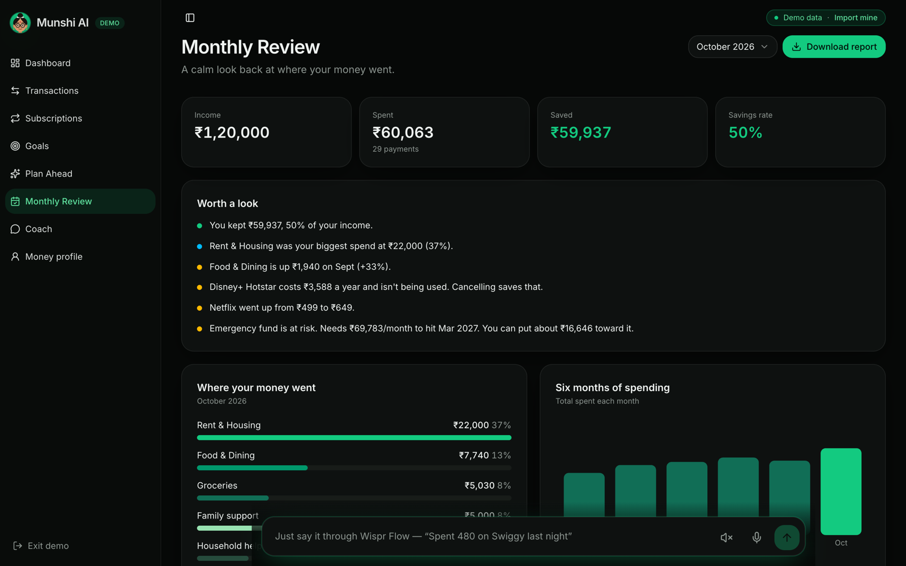<br /><b>Monthly review.</b> Where the money went, what changed, and a PDF report.</td>
    <td>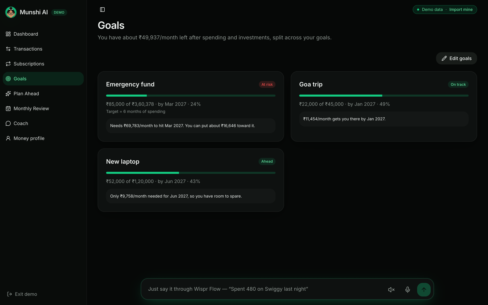<br /><b>Goals.</b> Each goal's status and the monthly amount it needs to land on time.</td>
  </tr>
  <tr>
    <td>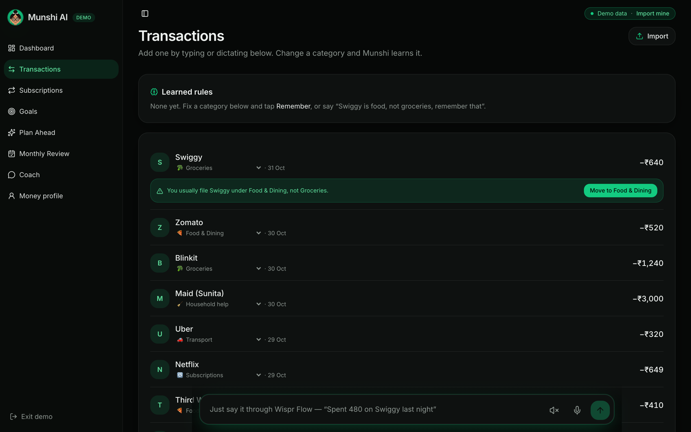<br /><b>Transactions.</b> Change a category and Munshi remembers it.</td>
    <td>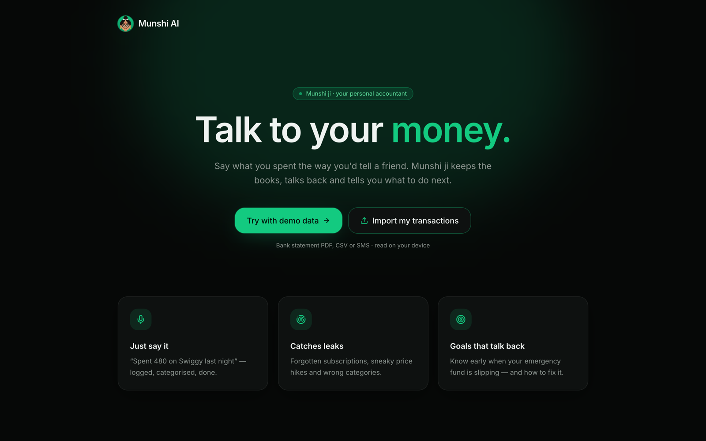<br /><b>Start in seconds.</b> Try the demo or import your own statement.</td>
  </tr>
</table>

<p align="center">
  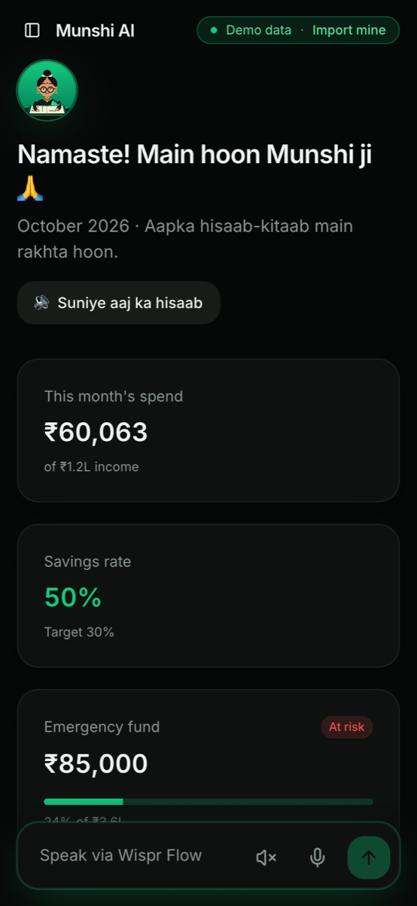<br />
  <sub>Works on phones too, where dictating with Wispr Flow feels most natural.</sub>
</p>

### 🛡️ Guardrails

Munshi **educates and models scenarios. It never recommends specific stocks, mutual funds or crypto.** That's enforced in three layers:

1. Questions asking for picks are answered **before any AI runs**, with an explanation of the concept instead.
2. The AI is instructed never to name a security.
3. Any AI answer that names one anyway is **blocked** and replaced.

Every refusal teaches something useful (emergency fund first, index funds vs single stocks) and points to a **SEBI-registered adviser**. The Coach is labelled *Educational only, not investment advice*.

### ⚡ Works with or without AI

Gemini handles voice parsing and Coach answers. If the AI is slow, unavailable or not configured, Munshi falls back to its **on-device** parser and rule-based coach, so the app never stops working. Each answer shows a **Gemini** or **On-device** badge so you know which one replied. The Gemini key stays on the server and is never sent to the browser.

## 🛠️ Tech stack

- **Framework:** React 19 + [TanStack Start](https://tanstack.com/start) (file-based routing, SSR, server functions)
- **UI:** Tailwind CSS v4, shadcn/ui (Radix), Lucide icons, Recharts
- **AI:** Google Gemini (`gemini-3.5-flash-lite`) through server functions, with on-device fallbacks
- **Voice:** [Wispr Flow](https://wisprflow.ai) dictation, the browser Web Speech API (`en-IN`) for the mic, and speech synthesis with a Hindi voice for replies
- **Import:** pdf.js for statements, plus hand-written CSV and bank-SMS parsers tuned for Indian banks
- **Data:** stored in the browser (localStorage); no account, no server database
- **Hosting:** Cloudflare Workers (free plan), auto-deployed from `main` with Cloudflare Workers Builds
- **Tests:** Vitest + Testing Library (165 tests)

## 🚀 Run it locally

You need **Node.js 20+**.

```bash
git clone https://github.com/Rehan6225/Munshi-AI.git
cd Munshi-AI
npm install
npm run dev
```

Open **http://localhost:5173** and click **Try with demo data**.

**Optional: switch on Gemini.** Get a free key at [Google AI Studio](https://aistudio.google.com/apikey) and create `.env.local` in the project root:

```bash
GEMINI_API_KEY=your-key-here
# Optional; this is the default:
GEMINI_MODEL=gemini-3.5-flash-lite
```

Restart `npm run dev`. Without a key, everything still works on-device.

| Command | What it does |
|---|---|
| `npm run dev` | Start the dev server |
| `npm run build` | Production build for Cloudflare Workers |
| `npm run test` | Run the tests |
| `npm run lint` | Lint the codebase |

## ☁️ Deploy your own (free)

1. Fork this repo.
2. In the [Cloudflare dashboard](https://dash.cloudflare.com), go to **Workers & Pages → Create → Import a repository** and pick your fork.
3. Set the build command to `npm run build` and the deploy command to `npx wrangler deploy`, then deploy.
4. Optional: under **Settings → Variables and Secrets**, add `GEMINI_API_KEY` as a **Secret**.

Every push to `main` redeploys automatically.

## 🗂️ Project structure

```
src/
├── routes/                 # One file per page (TanStack file-based routing)
│   ├── index.tsx               → Dashboard
│   ├── transactions.tsx        → Transactions + learned rules
│   ├── subscriptions.tsx       → Subscription radar
│   ├── goals.tsx               → Goals
│   ├── plan-ahead.tsx          → Plan Ahead simulator
│   ├── monthly-review.tsx      → Monthly review + PDF report
│   ├── coach.tsx               → Coach chat
│   ├── profile.tsx             → Money profile
│   └── welcome.tsx             → Landing page
├── components/
│   ├── voice-bar.tsx           # 🎙️ The voice command bar on every page
│   ├── heard-card.tsx          # "What Munshi heard"
│   ├── import-dialog.tsx       # PDF / CSV / SMS import and review
│   ├── munshi.tsx              # Munshi ji avatar, replies, mute
│   └── ui/                     # shadcn/ui components
└── lib/
    ├── voice.ts                # Speech → clean entries (fillers, corrections, many spends)
    ├── ai.functions.ts         # Gemini voice parsing (server)
    ├── coach.ts / coach.functions.ts / guardrails.ts   # Coach and its guardrails
    ├── recurring.ts            # Subscription and bill detection, price-hike and unused alerts
    ├── rules.ts                # Learned "merchant → category" rules
    ├── nudges.ts               # Drift and budget nudges
    ├── plan.ts / simulate.ts   # Goals and Plan Ahead
    ├── report.ts / review.ts   # Monthly review
    ├── importers/              # PDF, CSV and SMS parsers, auto-categories, sample files
    ├── munshi.ts / speech.ts   # Munshi ji's Hinglish replies and Hindi voice
    └── store.tsx               # App state, saving, demo data
```

## 🏆 Built for

**The Product Space AI Hackathon**, problem statement **04: Personal Finance Coach with a Living Money Model**.

The whole app was built **by voice**: every prompt, spec and fix was dictated with **Wispr Flow**.
